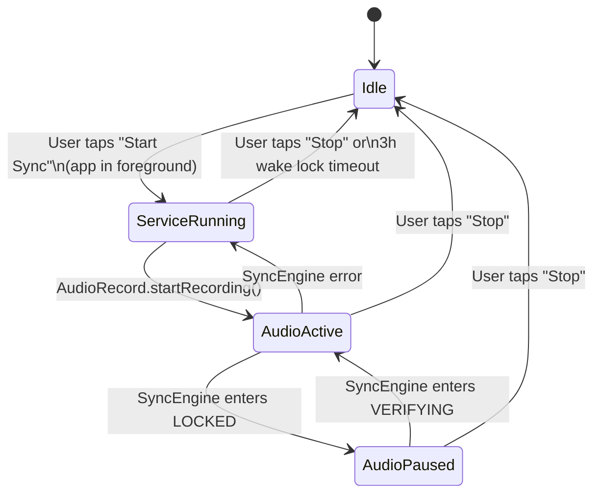
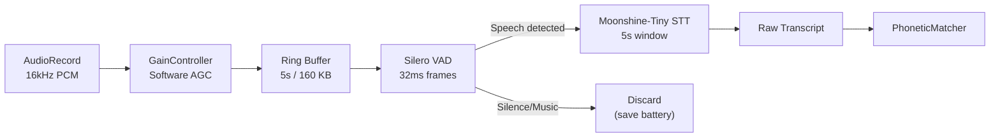
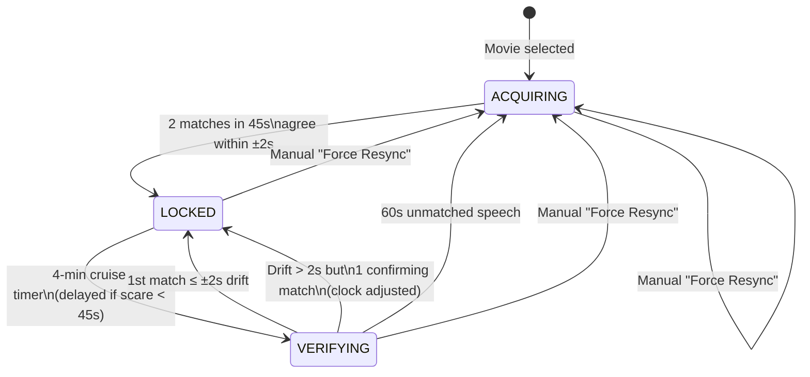

# SpookCue — Implementation Plan

> **Offline horror-movie jump-scare alerter.** Listens to distant movie audio → transcribes speech on-device → matches phonetic dialogue fingerprints against 1,164 horror films (~9,754 jump scares) → fires haptic/visual alerts ±2 s before the scare — all while the phone is locked in a pocket.

---

## Table of Contents

1. [Phase 0 — Repository Bootstrap & Tooling](#phase-0--repository-bootstrap--tooling)
2. [Phase 1 — Data Pipeline (GitHub Actions Scraper)](#phase-1--data-pipeline-github-actions-scraper)
3. [Phase 2 — Android Project Skeleton](#phase-2--android-project-skeleton)
4. [Phase 3 — Local Catalog & Movie Selection](#phase-3--local-catalog--movie-selection)
5. [Phase 4 — Foreground Service & Audio Capture](#phase-4--foreground-service--audio-capture)
6. [Phase 5 — Two-Stage Inference Engine (VAD + STT)](#phase-5--two-stage-inference-engine-vad--stt)
7. [Phase 6 — Phonetic Matching & 3-State Sync Engine](#phase-6--phonetic-matching--3-state-sync-engine)
8. [Phase 7 — Alert System (Haptics + Theater UI)](#phase-7--alert-system-haptics--theater-ui)
9. [Phase 8 — Delta-Sync Update Engine](#phase-8--delta-sync-update-engine)
10. [Phase 9 — Signing, Sideloading & Obtainium](#phase-9--signing-sideloading--obtainium)
11. [Phase 10 — Testing, Hardening & Launch](#phase-10--testing-hardening--launch)
12. [File Tree (Target)](#file-tree-target)
13. [Risk Register & Mitigations](#risk-register--mitigations)

---

## Phase 0 — Repository Bootstrap & Tooling

**Goal:** Single monorepo containing both the Python scraper and the Android app, with CI for both.

### 0.1 Repository Structure

```
SpookCue/
├── .github/
│   └── workflows/
│       ├── weekly_scrape.yml        # Phase 1 — runs every Sunday 00:00 UTC
│       └── release_apk.yml          # Phase 9 — builds signed APK on version tag
├── scraper/                         # Python 3.12 project
│   ├── pyproject.toml
│   ├── src/
│   │   └── spookcue_scraper/
│   │       ├── __init__.py
│   │       ├── main.py              # Orchestrator
│   │       ├── whenjumpscare.py     # WhenJumpScare HTML parser
│   │       ├── tmdb.py              # TMDB API client
│   │       ├── subtitles.py         # SubDL / OpenSubtitles fetcher
│   │       ├── sanitizer.py         # SRT → clean dialogue
│   │       ├── phonetics.py         # Double Metaphone encoder
│   │       └── resolver.py          # Anchor scares to dialogue
│   └── tests/
├── data/                            # Committed output (served via CDN)
│   ├── version.json                 # { "v": 42, "updated": "2026-10-20" }
│   ├── catalog.json                 # All 1,164 movies (lightweight)
│   └── movies/
│       ├── 138843.json              # The Conjuring
│       └── ...                      # One file per TMDB ID
├── app/                             # Android Kotlin project (Gradle)
│   ├── build.gradle.kts
│   ├── src/main/
│   │   ├── AndroidManifest.xml
│   │   ├── assets/                  # Bundled catalog + movie JSONs
│   │   │   ├── catalog.json
│   │   │   └── movies/             # Subset or full bundle
│   │   ├── java/dev/spookcue/
│   │   │   ├── SpookCueApp.kt
│   │   │   └── ... (see Phase 2)
│   │   └── res/
│   └── src/test/
├── models/                          # Git LFS or downloaded at build time
│   ├── silero_vad.onnx              # ~1.5 MB
│   └── moonshine-tiny.onnx          # ~60 MB (or whisper-tiny.en)
└── README.md
```

### 0.2 Tasks

| # | Task | Details |
|---|------|---------|
| 0.1 | Initialize Git repo | `git init`, `.gitignore` (Android + Python), `.gitattributes` for LFS |
| 0.2 | Set up Python env | `pyproject.toml` with deps: `httpx`, `beautifulsoup4`, `srt`, `metaphone`, `orjson` |
| 0.3 | Set up Android project | Android Studio Ladybug → New Project → Empty Compose Activity, `minSdk 26`, `targetSdk 35` |
| 0.4 | Configure GitHub secrets | `TMDB_API_KEY`, `SUBDL_API_KEY`, `KEYSTORE_BASE64`, `KEYSTORE_PASSWORD`, `KEY_ALIAS`, `KEY_PASSWORD` |
| 0.5 | Enable GitHub Pages | Settings → Pages → Deploy from `main` branch, `/data` folder (fallback CDN) |

---

## Phase 1 — Data Pipeline (GitHub Actions Scraper)

**Goal:** Fully automated, zero-maintenance weekly pipeline that produces `version.json`, `catalog.json`, and 1,164 `movies/{tmdb_id}.json` files.

### 1.1 WhenJumpScare Scraper (`whenjumpscare.py`)

| # | Task | Details |
|---|------|---------|
| 1.1.1 | Fetch movie index | `GET https://wheresthejumpscare.com/movies` — paginate all pages, extract movie slugs |
| 1.1.2 | Parse individual movie pages | For each slug: extract title, year, jump scare timestamps, scare type (minor/major), and text descriptions |
| 1.1.3 | Extract TMDB ID from slug | Many slugs map to TMDB IDs; fallback to TMDB search API `GET /search/movie?query={title}&year={year}` |
| 1.1.4 | Polite rate limiting | 2-second delay between requests; respect `robots.txt` |
| 1.1.5 | Diff against existing | Only scrape movies not already in `data/movies/`; track additions in a scrape log |

### 1.2 TMDB Metadata Fetcher (`tmdb.py`)

| # | Task | Details |
|---|------|---------|
| 1.2.1 | Fetch movie details | `GET /movie/{tmdb_id}` → runtime, poster_path, genres, original_language |
| 1.2.2 | Cache & refresh policy | Re-fetch metadata if local file is older than 6 months (TMDB TOS compliance) |
| 1.2.3 | Rate limiting | TMDB allows 40 req/10s; use a token-bucket limiter |

### 1.3 Subtitle Downloader (`subtitles.py`)

| # | Task | Details |
|---|------|---------|
| 1.3.1 | Primary source: SubDL | `GET /api/v1/subtitles?tmdb_id={id}&languages=en&type=srt` |
| 1.3.2 | Fallback: OpenSubtitles | If SubDL returns no results, try OpenSubtitles REST API |
| 1.3.3 | SRT parsing | Use `srt` library to parse into `Subtitle(index, start, end, content)` objects |
| 1.3.4 | Graceful missing subs | If no English SRT found, mark movie as `"has_subtitles": false` in catalog; skip phonetic indexing but still include jump scare times (clock-only mode) |

### 1.4 Subtitle Sanitization (`sanitizer.py`)

| # | Task | Details |
|---|------|---------|
| 1.4.1 | Strip HTML/formatting | Remove `<i>`, `<b>`, `<font>`, `{\an8}` ASS positioning tags |
| 1.4.2 | Strip SDH annotations | Remove `[creaking]`, `(GASPS)`, `♪ music ♪`, `- narrator:` prefixes |
| 1.4.3 | Strip uploader watermarks | Remove lines matching common patterns: `Subtitles by...`, `Synced & corrected by...` |
| 1.4.4 | Clause concatenation | Merge consecutive subtitle blocks separated by < 400 ms gap into 2-block and 3-block sliding windows |
| 1.4.5 | Stopword removal | Strip: `oh`, `ah`, `uh`, `um`, `whoa`, `hey`, `yeah`, `hmm`, `huh`, `okay` |
| 1.4.6 | Minimum entropy filter | Discard lines with < 4 remaining words OR < 12 total consonant characters |

### 1.5 Double Metaphone Encoder (`phonetics.py`)

| # | Task | Details |
|---|------|---------|
| 1.5.1 | Encode each word | Use `metaphone` library → primary code for each word |
| 1.5.2 | Build phonetic index | Array of `{ "s": start_ms, "p": [phonetic_tokens...] }` sorted by timestamp |
| 1.5.3 | Compression check | Verify average per-movie JSON ≈ 2.8 KB gzipped |

### 1.6 Jump Scare Resolver (`resolver.py`)

| # | Task | Details |
|---|------|---------|
| 1.6.1 | For each scare timestamp | Find the closest preceding subtitle line (within 60s before the scare) |
| 1.6.2 | Compute `offset_from_anchor_ms` | `scare_time - subtitle_start_time` |
| 1.6.3 | Store anchor phonetics | Copy the phonetic array of the anchor line into the scare object |
| 1.6.4 | Handle dialogue-free scares | If no subtitle within 60s before scare, set `anchor_phonetic: null` and use `resolved_time_ms` with clock-only sync |

### 1.7 Output & Commit (`main.py`)

| # | Task | Details |
|---|------|---------|
| 1.7.1 | Generate `version.json` | `{ "v": <incremented>, "updated": "<ISO date>", "movie_count": 1164, "scare_count": 9754 }` |
| 1.7.2 | Generate `catalog.json` | Array of `{ tmdb_id, title, release_year, runtime_minutes, scare_count, poster_path, has_subtitles }` |
| 1.7.3 | Generate per-movie JSONs | Write `data/movies/{tmdb_id}.json` with schema from spec |
| 1.7.4 | Git commit & push | Only if files changed; commit message: `chore(data): scrape v{N} — {added} new, {updated} refreshed` |

### 1.8 GitHub Actions Workflow (`weekly_scrape.yml`)

```yaml
name: Weekly Scrape
on:
  schedule:
    - cron: '0 0 * * 0'   # Every Sunday at 00:00 UTC
  workflow_dispatch: {}     # Manual trigger for testing

jobs:
  scrape:
    runs-on: ubuntu-latest
    timeout-minutes: 120
    steps:
      - uses: actions/checkout@v4
      - uses: actions/setup-python@v5
        with:
          python-version: '3.12'
      - run: pip install -e ./scraper
      - run: python -m spookcue_scraper
        env:
          TMDB_API_KEY: ${{ secrets.TMDB_API_KEY }}
          SUBDL_API_KEY: ${{ secrets.SUBDL_API_KEY }}
      - uses: stefanzweifel/git-auto-commit-action@v5
        with:
          commit_message: "chore(data): weekly scrape update"
          file_pattern: "data/**"
```

> [!IMPORTANT]
> The scraper must be idempotent — re-running it on a fully populated `data/` directory should produce zero git diffs unless WhenJumpScare has genuinely added/changed content.

---

## Phase 2 — Android Project Skeleton

**Goal:** Buildable Compose app with DI, navigation, and all modules stubbed.

### 2.1 Gradle & Dependencies

| # | Task | Details |
|---|------|---------|
| 2.1.1 | Configure `build.gradle.kts` (project) | Version catalog (`libs.versions.toml`), Kotlin 2.0, Compose BOM, AGP |
| 2.1.2 | Configure `build.gradle.kts` (app) | `minSdk 26`, `targetSdk 35`, Compose, Hilt, Room, OkHttp, Moshi/kotlinx-serialization |
| 2.1.3 | Signing config | `signingConfigs.release` referencing keystore properties from `local.properties` or env vars |

### 2.2 Package Structure

```
dev.spookcue/
├── SpookCueApp.kt                 # Application class, Hilt entry point
├── MainActivity.kt                # Single-activity Compose host
├── di/                            # Hilt modules
│   ├── AppModule.kt               # Singletons: DB, OkHttp, Prefs
│   ├── AudioModule.kt             # AudioRecord, VAD, STT providers
│   └── DataModule.kt              # Repository, CatalogManager
├── data/
│   ├── local/
│   │   ├── CatalogDatabase.kt     # Room DB: movies table, FTS
│   │   ├── MovieDao.kt
│   │   ├── MovieEntity.kt
│   │   └── AssetLoader.kt         # Loads bundled JSONs from assets/
│   ├── remote/
│   │   ├── CdnClient.kt           # jsDelivr primary, GitHub Pages fallback
│   │   └── DeltaSyncManager.kt    # Checks version.json, downloads new movies
│   ├── model/
│   │   ├── Movie.kt               # Domain model
│   │   ├── JumpScare.kt
│   │   └── PhoneticEntry.kt
│   └── repository/
│       └── MovieRepository.kt     # Single source of truth
├── audio/
│   ├── AudioCaptureManager.kt     # AudioRecord wrapper
│   ├── GainController.kt          # Software AGC / RMS normalizer
│   ├── VadEngine.kt               # Silero VAD ONNX inference
│   └── SttEngine.kt               # Moonshine/Whisper ONNX inference
├── sync/
│   ├── PhoneticMatcher.kt         # Double Metaphone tokenizer + Token Set Ratio
│   ├── SyncEngine.kt              # 3-state machine (ACQUIRING → LOCKED → VERIFYING)
│   ├── MovieClock.kt              # Monotonic clock with anchor snapping
│   └── SyncState.kt               # Sealed class: Acquiring | Locked | Verifying
├── alert/
│   ├── HapticManager.kt           # VibrationEffect waveforms
│   ├── ScareScheduler.kt          # Schedules alerts based on MovieClock
│   └── NotificationManager.kt     # Foreground notification + lock-screen actions
├── service/
│   └── SpookCueService.kt         # Foreground service (microphone type)
├── ui/
│   ├── theme/
│   │   ├── Theme.kt               # SpookCue dark theme
│   │   ├── Color.kt               # Crimson palette
│   │   └── Type.kt
│   ├── navigation/
│   │   └── NavGraph.kt
│   ├── screens/
│   │   ├── home/
│   │   │   ├── HomeScreen.kt      # Movie search & selection
│   │   │   └── HomeViewModel.kt
│   │   ├── sync/
│   │   │   ├── SyncScreen.kt      # Active sync UI (theater mode)
│   │   │   └── SyncViewModel.kt
│   │   └── settings/
│   │       ├── SettingsScreen.kt
│   │       └── SettingsViewModel.kt
│   └── components/
│       ├── MovieCard.kt
│       ├── ScareTimeline.kt
│       ├── PulseOverlay.kt        # Peripheral crimson pulse
│       └── ManualSyncControls.kt  # ±1s, ±10s, Force Resync buttons
└── util/
    ├── DoubleMetaphone.kt          # Kotlin port or JNI binding
    ├── TokenSetRatio.kt            # Fuzzy phonetic matching
    └── Extensions.kt
```

### 2.3 Tasks

| # | Task | Details |
|---|------|---------|
| 2.3.1 | Create Android project | Android Studio → New Project → Empty Compose → package `dev.spookcue` |
| 2.3.2 | Add all Gradle deps | Compose BOM, Hilt, Room, kotlinx-serialization, OkHttp, ONNX Runtime |
| 2.3.3 | Set up Hilt DI | `@HiltAndroidApp`, `@AndroidEntryPoint`, module stubs |
| 2.3.4 | Set up Navigation | Compose Navigation with `HomeScreen`, `SyncScreen`, `SettingsScreen` |
| 2.3.5 | Set up Room database | `CatalogDatabase` with `MovieEntity`, DAO, FTS4 virtual table for search |
| 2.3.6 | Dark theme | `#000000` background, crimson accents (`#8B0000`, `#450000`, `#300000`) |

---

## Phase 3 — Local Catalog & Movie Selection

**Goal:** User can browse/search all 1,164 movies instantly offline, see poster thumbnails, and select one to sync.

### 3.1 Tasks

| # | Task | Details |
|---|------|---------|
| 3.1.1 | `AssetLoader` | On first launch, parse `assets/catalog.json` → insert into Room `movies` table |
| 3.1.2 | FTS search | Room FTS4 on `title` column; results in < 1 ms |
| 3.1.3 | `HomeScreen` UI | Search bar + LazyColumn of `MovieCard`s showing poster, title, year, scare count |
| 3.1.4 | Poster loading | Coil/Glide loading TMDB poster URLs (`https://image.tmdb.org/t/p/w185/{poster_path}`); placeholder skull icon if offline |
| 3.1.5 | Movie detail bottom sheet | Shows scare timeline, start button, "last synced" info |
| 3.1.6 | Per-movie JSON loading | On movie selection, load `assets/movies/{tmdb_id}.json` or fetch from CDN if newer version exists |

---

## Phase 4 — Foreground Service & Audio Capture

**Goal:** Persistent microphone foreground service that survives screen-off, pocket, and Doze mode.

### 4.1 Tasks

| # | Task | Details |
|---|------|---------|
| 4.1.1 | Declare permissions in Manifest | `RECORD_AUDIO`, `FOREGROUND_SERVICE`, `FOREGROUND_SERVICE_MICROPHONE`, `WAKE_LOCK`, `VIBRATE`, `POST_NOTIFICATIONS`, `REQUEST_IGNORE_BATTERY_OPTIMIZATIONS` |
| 4.1.2 | Runtime permission flow | Compose permission request dialog for `RECORD_AUDIO` and `POST_NOTIFICATIONS` |
| 4.1.3 | `SpookCueService` | `Service` with `startForeground(FOREGROUND_SERVICE_TYPE_MICROPHONE)`, persistent notification |
| 4.1.4 | Start constraint | Service starts ONLY when user taps "Start Sync" with app in foreground (Android 14+ rule) |
| 4.1.5 | `PARTIAL_WAKE_LOCK` | Acquired on service start, released on stop; 3-hour safety timeout |
| 4.1.6 | Battery optimization bypass | On first launch: check `isIgnoringBatteryOptimizations()` → prompt `ACTION_REQUEST_IGNORE_BATTERY_OPTIMIZATIONS` |
| 4.1.7 | `AudioCaptureManager` | Initialize `AudioRecord(UNPROCESSED, 16kHz, MONO, PCM_16BIT)`; fallback to `MIC` source |
| 4.1.8 | Disable HW effects | Explicitly disable `NoiseSuppressor` and `AcousticEchoCanceler` on the `AudioRecord` session |
| 4.1.9 | `GainController` | Software AGC: compute RMS over 160-sample frames, apply gain to normalize to target RMS |
| 4.1.10 | Audio pipeline thread | Dedicated `HandlerThread` reading PCM → AGC → ring buffer (5s × 16kHz × 2 bytes = 160 KB) |

### 4.2 Lifecycle Diagram



---

## Phase 5 — Two-Stage Inference Engine (VAD + STT)

**Goal:** On-device speech detection and transcription with minimal battery drain.

### 5.1 Stage 1 — Silero VAD

| # | Task | Details |
|---|------|---------|
| 5.1.1 | Bundle model | `assets/silero_vad.onnx` (~1.5 MB) |
| 5.1.2 | `VadEngine` | Load ONNX model via `ort` (ONNX Runtime Android); process 32 ms (512 sample) frames |
| 5.1.3 | Speech segment detection | Emit `SpeechSegment(startMs, endMs)` events when VAD transitions from speech → silence (with 300 ms hangover) |
| 5.1.4 | Pre-filter stats | Log ratio of speech frames / total frames for battery optimization tuning |

### 5.2 Stage 2 — Local STT (Moonshine-Tiny)

| # | Task | Details |
|---|------|---------|
| 5.2.1 | Model selection | **Primary:** Moonshine-Tiny ONNX (~40 MB, optimized for short utterances). **Fallback:** Whisper-Tiny.en via sherpa-onnx (~75 MB) |
| 5.2.2 | Bundle or download | Ship model in APK `assets/` OR download on first launch (with progress UI) — depending on final APK size budget |
| 5.2.3 | `SttEngine` | sherpa-onnx JNI wrapper; accepts 16kHz PCM float array, returns `TranscriptionResult(text, confidence)` |
| 5.2.4 | Sliding window | **5-second buffer, 2-second stride**: on each VAD speech segment, feed the most recent 5s of audio. Stride ensures overlapping coverage |
| 5.2.5 | Memory safety | Overwrite PCM buffer positions immediately after STT inference completes (zero audio retention) |
| 5.2.6 | Inference thread | Dedicated background `CoroutineDispatcher` (single-threaded) to avoid contention with audio capture |

### 5.3 Integration Flow



---

## Phase 6 — Phonetic Matching & 3-State Sync Engine

**Goal:** Lock onto movie playback within ±2 seconds using phonetic fingerprinting, maintain sync with minimal battery use.

### 6.1 Phonetic Matcher (`PhoneticMatcher.kt`)

| # | Task | Details |
|---|------|---------|
| 6.1.1 | `DoubleMetaphone.kt` | Kotlin port of Lawrence Philips' Double Metaphone algorithm (or JNI binding to Apache Commons Codec) |
| 6.1.2 | Transcript preprocessing | Strip stopwords, apply minimum entropy filter (≥ 4 tokens, ≥ 12 consonant chars) |
| 6.1.3 | Token Set Ratio scorer | Compute `intersection_size / union_size` between STT phonetic tokens and candidate subtitle phonetic tokens |
| 6.1.4 | Match threshold | ≥ 80% Token Set Ratio = positive match |
| 6.1.5 | Search implementation | **Full scan:** Linear scan of movie's `phonetic_index` array (< 3 ms for ~500 entries). **Bounded scan:** Binary search to ±90s window around current clock |

### 6.2 Movie Clock (`MovieClock.kt`)

| # | Task | Details |
|---|------|---------|
| 6.2.1 | Monotonic time source | `SystemClock.elapsedRealtime()` — survives deep sleep, never jumps |
| 6.2.2 | Anchor snap | On sync lock: `t_anchor = matched_subtitle_ms`, `t_sys_anchor = elapsedRealtime()` |
| 6.2.3 | Current time computation | `t_movie = t_anchor + (elapsedRealtime() - t_sys_anchor)` — recomputed on every query, never drifts |
| 6.2.4 | Manual adjust | `±1s`, `±5s`, `±10s` buttons simply shift `t_anchor` |

### 6.3 Sync State Machine (`SyncEngine.kt`)

| # | Task | Details |
|---|------|---------|
| 6.3.1 | `ACQUIRING` state | Search full movie index. Record candidate offsets. Require **2 matches within 45s** that agree within ±2s → snap clock → `LOCKED` |
| 6.3.2 | `LOCKED` state | Pause mic & STT. Run countdown timers for upcoming scares. Wake into `VERIFYING` every 4 minutes (delay if scare < 45s away) |
| 6.3.3 | `VERIFYING` state | Resume mic & STT. Search ±90s window. First match within ±2s → back to `LOCKED`. Drift > 2s → require 1 confirming match to adjust. 60s of unmatched speech → `ACQUIRING` |
| 6.3.4 | State observers | Expose `StateFlow<SyncState>` for UI and service to observe |

### 6.4 State Machine Diagram



---

## Phase 7 — Alert System (Haptics + Theater UI)

**Goal:** Alerts the user 10 seconds before each jump scare via haptics (pocket mode) and/or visual pulses (theater mode).

### 7.1 Haptic Alerts (`HapticManager.kt`)

| # | Task | Details |
|---|------|---------|
| 7.1.1 | Minor scare (10s prior) | Double-tap: `timings=[0,150,100,150]`, `amplitudes=[0,140,0,140]` |
| 7.1.2 | Major scare — 10s prior | Heartbeat intro: `timings=[0,200,120,350]`, `amplitudes=[0,200,0,200]` |
| 7.1.3 | Major scare — 5s prior | Heavy heartbeat: `timings=[0,200,120,350]`, `amplitudes=[0,230,0,230]` |
| 7.1.4 | Major scare — 2s prior | Full intensity: `timings=[0,250,120,450]`, `amplitudes=[0,255,0,255]` |
| 7.1.5 | Haptic API compat | Use `VibrationEffect.createWaveform()` on API 26+; fallback `Vibrator.vibrate(pattern)` |

### 7.2 Scare Scheduler (`ScareScheduler.kt`)

| # | Task | Details |
|---|------|---------|
| 7.2.1 | Schedule from clock | When `LOCKED`, compute `scare_time - movie_clock` for all upcoming scares |
| 7.2.2 | Alert windows | Schedule haptic/visual alerts at scare_time − 10s, − 5s (major only), − 2s (major only) |
| 7.2.3 | Reschedule on clock adjust | Cancel and recompute all pending alerts when clock is adjusted |
| 7.2.4 | Handler-based timing | Use `Handler.postDelayed()` on the service's `HandlerThread` (wake lock keeps CPU alive) |

### 7.3 Theater Mode UI (`SyncScreen.kt`)

| # | Task | Details |
|---|------|---------|
| 7.3.1 | OLED black canvas | `#000000` background, zero system UI chrome |
| 7.3.2 | Crimson typography | Dim crimson `#450000` for text, `#8B0000` for accents |
| 7.3.3 | Status display | Current sync state, movie title, current time code, next scare countdown |
| 7.3.4 | Peripheral crimson pulse | `PulseOverlay` composable: animate background `#000000` ↔ `#300000` at 2 Hz, starting 10s before major scare. Toggle in settings |
| 7.3.5 | Manual sync controls | `−10s`, `−1s`, `+1s`, `+10s`, "Force Resync" buttons |
| 7.3.6 | Screen brightness | Set `WindowManager.LayoutParams.screenBrightness = 0.01f` (minimum) during theater mode |

### 7.4 Lock-Screen Notification (`NotificationManager.kt`)

| # | Task | Details |
|---|------|---------|
| 7.4.1 | Persistent notification | Shows movie title, sync state, next scare countdown |
| 7.4.2 | Action buttons | `−5s`, `+5s`, `Resync`, `Stop` — via `PendingIntent` to service |
| 7.4.3 | Update frequency | Update notification text every 1s when scare is < 30s away; every 10s otherwise |
| 7.4.4 | Notification channel | "SpookCue Sync" channel, importance LOW (no sound), visibility PUBLIC (show on lock screen) |

---

## Phase 8 — Delta-Sync Update Engine

**Goal:** Keep the local movie database fresh with new scrapes, using minimal bandwidth.

### 8.1 Tasks

| # | Task | Details |
|---|------|---------|
| 8.1.1 | `CdnClient.kt` | Primary: `https://cdn.jsdelivr.net/gh/{user}/{repo}@main/data/...`; Fallback: `https://{user}.github.io/{repo}/data/...` |
| 8.1.2 | Version check | On app launch (if online), `GET version.json`. If remote `v > local_v`, trigger delta sync |
| 8.1.3 | Catalog diff | Download new `catalog.json`, diff against local Room DB, identify added/removed TMDB IDs |
| 8.1.4 | Incremental movie download | Download only new `movies/{tmdb_id}.json` files; update Room DB |
| 8.1.5 | CDN failover | If jsDelivr returns 5xx or times out (3s), automatically retry with GitHub Pages URL |
| 8.1.6 | Background sync | Use `WorkManager` with `NetworkType.CONNECTED` constraint for non-urgent updates |
| 8.1.7 | Sync status UI | Settings screen shows: last sync date, local version, available version, "Sync Now" button |

---

## Phase 9 — Signing, Sideloading & Obtainium

**Goal:** Repeatable signed release builds, painless first install, and automatic updates.

### 9.1 Tasks

| # | Task | Details |
|---|------|---------|
| 9.1.1 | Generate signing key | `keytool -genkey -v -keystore release-key.jks -keyalg RSA -keysize 2048 -validity 10000` |
| 9.1.2 | Configure Gradle signing | `signingConfigs.release` in `build.gradle.kts` reading from env vars |
| 9.1.3 | CI release workflow | `.github/workflows/release_apk.yml`: on tag push `v*` → build signed APK → upload to GitHub Releases |
| 9.1.4 | First install guide | README section on Wireless ADB / Bugjaeger / Termux `adb install -r` |
| 9.1.5 | Obtainium config | Document: install Obtainium → add GitHub repo URL → enable auto-update notifications |

### 9.2 Release Workflow (`release_apk.yml`)

```yaml
name: Release APK
on:
  push:
    tags: ['v*']

jobs:
  build:
    runs-on: ubuntu-latest
    steps:
      - uses: actions/checkout@v4
      - uses: actions/setup-java@v4
        with:
          java-version: '17'
          distribution: 'temurin'
      - name: Decode Keystore
        run: echo "${{ secrets.KEYSTORE_BASE64 }}" | base64 -d > app/release-key.jks
      - name: Build Release APK
        run: ./gradlew assembleRelease
        env:
          KEYSTORE_PASSWORD: ${{ secrets.KEYSTORE_PASSWORD }}
          KEY_ALIAS: ${{ secrets.KEY_ALIAS }}
          KEY_PASSWORD: ${{ secrets.KEY_PASSWORD }}
      - name: Upload to Release
        uses: softprops/action-gh-release@v2
        with:
          files: app/build/outputs/apk/release/app-release.apk
```

---

## Phase 10 — Testing, Hardening & Launch

### 10.1 Unit Tests

| # | Component | Test Cases |
|---|-----------|------------|
| 10.1.1 | `DoubleMetaphone` | Known word pairs: "night"/"knight", "cellar"/"seller", "pale"/"pail" produce identical codes |
| 10.1.2 | `TokenSetRatio` | Score ≥ 80% for fuzzy matches; score < 50% for unrelated phrases |
| 10.1.3 | `SyncEngine` state transitions | ACQUIRING→LOCKED on 2 agreeing matches; LOCKED→VERIFYING on timer; VERIFYING→ACQUIRING on 60s timeout |
| 10.1.4 | `MovieClock` | Verify `t_movie` accuracy within 1 ms after simulated `elapsedRealtime` jumps |
| 10.1.5 | `Sanitizer` | SDH tags stripped, clause concatenation correct, entropy filter applied |

### 10.2 Integration Tests

| # | Scenario | Method |
|---|----------|--------|
| 10.2.1 | End-to-end sync | Play "The Conjuring" audio clip through speaker → app acquires sync within 2 minutes |
| 10.2.2 | Drift recovery | Pause movie for 30s mid-playback → resume → app detects drift in next VERIFYING cycle |
| 10.2.3 | Haptic timing | Log haptic fire timestamps vs. actual scare times → verify ±2s accuracy |
| 10.2.4 | Battery drain | 2-hour session → measure battery delta (target: < 8% drain) |
| 10.2.5 | Doze survival | Lock phone, leave stationary for 30 min → verify service still alive and timers fire |

### 10.3 Device Matrix

| Device | OS | Priority | Notes |
|--------|----|----------|-------|
| Samsung Galaxy (OneUI) | Android 14+ | **P0** | Test aggressive battery killer |
| OnePlus (OxygenOS) | Android 13+ | P0 | Test background restrictions |
| Xiaomi (HyperOS) | Android 13+ | P1 | Test autostart permissions |
| Pixel | Android 15+ | P1 | Reference AOSP behavior |

---

## File Tree (Target)

```
SpookCue/
├── .github/workflows/
│   ├── weekly_scrape.yml
│   └── release_apk.yml
├── scraper/
│   ├── pyproject.toml
│   ├── src/spookcue_scraper/
│   │   ├── __init__.py
│   │   ├── main.py
│   │   ├── whenjumpscare.py
│   │   ├── tmdb.py
│   │   ├── subtitles.py
│   │   ├── sanitizer.py
│   │   ├── phonetics.py
│   │   └── resolver.py
│   └── tests/
│       ├── test_sanitizer.py
│       ├── test_phonetics.py
│       └── test_resolver.py
├── data/
│   ├── version.json
│   ├── catalog.json
│   └── movies/
│       └── {tmdb_id}.json  (×1,164)
├── app/
│   ├── build.gradle.kts
│   ├── src/main/
│   │   ├── AndroidManifest.xml
│   │   ├── assets/
│   │   │   ├── catalog.json
│   │   │   ├── silero_vad.onnx
│   │   │   ├── moonshine-tiny.onnx
│   │   │   └── movies/ (bundled)
│   │   ├── java/dev/spookcue/  (see Phase 2 tree)
│   │   └── res/
│   └── src/test/
├── models/
│   ├── silero_vad.onnx
│   └── moonshine-tiny.onnx
└── README.md
```

---

## Risk Register & Mitigations

| # | Risk | Impact | Likelihood | Mitigation |
|---|------|--------|------------|------------|
| R1 | WhenJumpScare changes HTML structure | Scraper breaks | Medium | CSS selector tests in CI; alert on scrape failure; manual review |
| R2 | TMDB API rate limit hit during bulk scrape | Incomplete metadata | Low | Token-bucket limiter; incremental scraping; cache aggressively |
| R3 | No English subtitles for a movie | No phonetic sync | Medium | Fallback to clock-only mode using raw scare timestamps; UI shows "reduced accuracy" badge |
| R4 | OEM battery killers terminate service | Missed alerts | High | `REQUEST_IGNORE_BATTERY_OPTIMIZATIONS` + user-facing setup guide linking to [dontkillmyapp.com](https://dontkillmyapp.com) |
| R5 | Distant/muffled audio → poor STT accuracy | Failed sync | Medium | Software AGC; Double Metaphone tolerates phonetic errors; lower match threshold to 70% in noisy mode |
| R6 | GitHub Actions free tier limits | Scraper can't run | Low | 2,000 min/month free; scrape takes ~30 min; well within budget |
| R7 | jsDelivr caches stale `version.json` | Users miss updates | Low | Use `@main` ref (purged within 24h); fallback to GitHub Pages (no CDN cache) |
| R8 | APK size too large with bundled model | Install friction | Medium | Option 1: Download model on first launch. Option 2: Use Moonshine-Tiny (~40 MB) instead of Whisper (~75 MB) |
| R9 | Subtitle timing mismatch across editions | Wrong anchor offset | Medium | Edition-proofing via dialogue-relative anchoring; VERIFYING state corrects drift |
| R10 | Google Play Protect blocks sideloaded APK | Install fails | Medium | First install via ADB bypasses Protect; Obtainium updates install over existing signed app |

---

> [!TIP]
> **Recommended build order:** Phase 0 → 1 → 2 → 3 → 6 (with mock data) → 4 → 5 → 7 → 8 → 9 → 10. Building the sync engine (Phase 6) early with hardcoded test data lets you validate the core algorithm before wiring up real audio.
